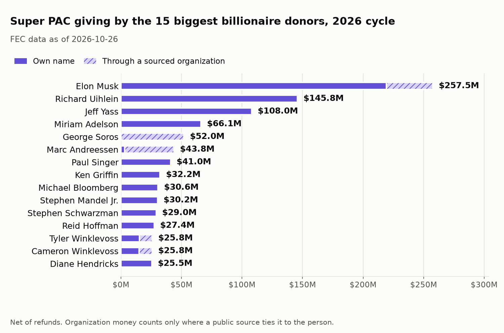
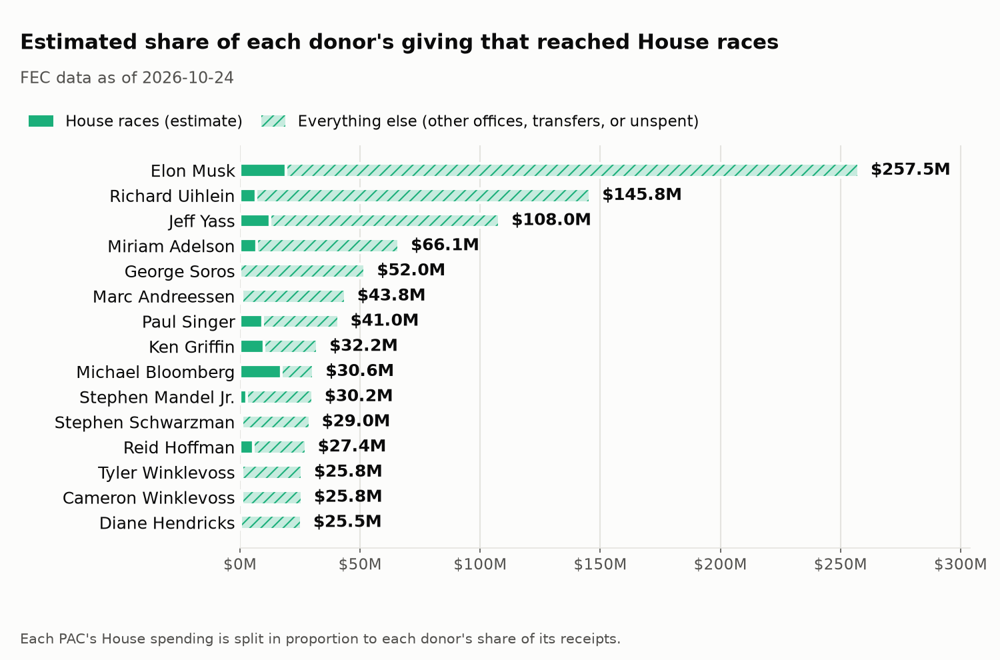
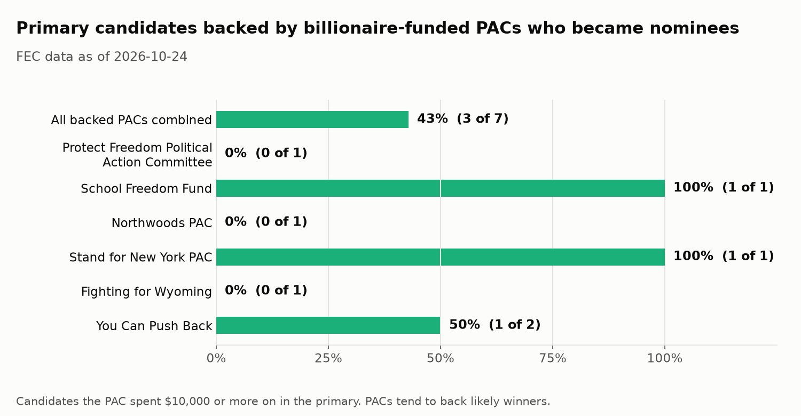

# Billionaire Money in the 2026 House Races

*Section 2 of the Midterm Money 2026 write-up. FEC donor data pulled October 26, 2026, covering reports through the pre-general period that ended October 14. Spending data as of October 24, 2026.*

## The question

Which billionaires are giving to 2026 super PACs, how much of that reached House races, and which super PACs are mostly funded by one billionaire? For the PACs funded that way, the section also looks at how the primary candidates they backed did. It reports who gave, where the money went, and which party the spending helped. It does not try to measure whether the money changed any result.

All figures come from `scripts/build_billionaire_report.py`, which reads the database and the research files and writes the charts and [`billionaire_money_numbers.json`](figures/billionaire_money_numbers.json). Every number below can be checked against that file.

## How billionaires and their organizations were identified

A billionaire is a person on the Forbes World's Billionaires list (April 2026 edition). Spouses are combined into one household when Forbes lists them together or a public source says the couple gives together. The same rule applies to every donor. The people, the spellings of their names in FEC data, and a Forbes link for each are in [`data/manual/billionaires.csv`](../data/manual/billionaires.csv).

Many large donors give through a company, a family trust, or a nonprofit. Money from an organization counts for a billionaire only when a public source ties the two together: an FEC filing that names the person, the person's own statement, or a major news outlet. Each link and its source are in [`data/manual/donor_entities.csv`](../data/manual/donor_entities.csv). Some firms' filings split each gift between partners (a16z reports each gift as half Andreessen and half Horowitz), so a link can carry a share, and only the share that belongs to a listed billionaire is counted.

Every organization that gave $1 million or more was reviewed and classified, whether or not it was linked to a billionaire. The result is in [`data/manual/org_donors_reviewed.csv`](../data/manual/org_donors_reviewed.csv). Individuals of $1 million or more who are not on the Forbes list are in [`data/manual/large_donors_not_on_forbes.csv`](../data/manual/large_donors_not_on_forbes.csv).

## Findings

### Giving

68 billionaire households gave $1.17B to 2026 super PACs. $1.01B of that was given in their own names and $163.3M through organizations with a sourced link. Amounts are net of refunds, and memo rows that repeat another row are left out.

The five largest are Elon Musk ($257.5M), Richard Uihlein ($145.8M), Jeff Yass ($108.0M), Miriam Adelson ($66.1M), and George Soros ($52.0M). All of Soros's total went through organizations. Most of Marc Andreessen's $43.8M did as well, because his firm's filings split each gift between him and a partner and only his half is counted.

### Where it went: House races

An estimated $139.8M of the $1.17B reached House races, which is 12%. The estimate splits each PAC's House spending (support and opposition, primary and general) in proportion to each donor's share of the PAC's receipts. A donor who supplied a quarter of a PAC's money is credited with a quarter of its House spending.

The share varies widely by donor. Michael Bloomberg's was 57% ($17.3M of $30.6M), Ken Griffin's 31%, Paul Singer's 23%, and Reid Hoffman's 20%. Musk's was 7% ($19.2M of $257.5M), and Uihlein's 5%. Soros's was $0, because Democracy PAC, the PAC his giving went to, reported no independent expenditures this cycle. The rest of a donor's giving went to other offices such as the Senate, to transfers and other costs, or has not been spent yet.

### Which party the spending helped

Which party the money helped is computed from the spending, not assigned by hand. Supporting a Democrat or opposing a Republican counts as helping Democrats, and the reverse helps Republicans. Spending on candidates of other parties counts for neither side.

By that measure, $934.6M of the giving came from donors whose House spending helped Republicans more than Democrats, $173.9M from donors whose spending helped Democrats more, and $62.0M from donors with no House spending. Among the 15 largest donors, Bloomberg, Stephen Mandel Jr., and Reid Hoffman were the three whose spending helped Democrats. The other 11 helped Republicans, and Soros has no House spending.

This count is lopsided, and it is a count of what could be traced to a named person. It is not a measure of how much each party's side has spent. Organizations that do not disclose their donors gave $506.5M to super PACs that this analysis could not trace to a person, and party-aligned nonprofits gave another $430.8M. Those amounts are not in either side's total above, so the real balance of billionaire money is not known.

### Billionaire-backed super PACs

A super PAC is billionaire-backed here if one billionaire, together with their sourced organizations, supplied at least 50% of its receipts for the cycle. There is no joint threshold, so two donors at 30% each do not make a PAC billionaire-backed.

Before a PAC is labeled, the contributions we hold for it are compared with the receipts it reports. Where they differ by more than 5%, the PAC is reported as unreconciled and is never labeled backed. 46 PACs where a billionaire held at least 20% were tested, and 42 reconciled.

27 super PACs are billionaire-backed. The largest are America PAC (Musk, 100% of $216.0M), Restoration of America PAC (Uihlein, 97% of $140.9M), Democracy PAC (Soros, 51% of $102.8M), and V-PAC (Yass, 50% of $59.7M). The full list, with each PAC's share and receipts, is in the numbers file. 51 Percent PAC ($20,000 in receipts) is on the list for two donors, because Cameron and Tyler Winklevoss each supplied exactly half.

6 more PACs are near the line, at 35% to 50%: Great Opportunity PAC (Yass, 49%), Aurora Action Network (Musk, 47%), Invest in Tomorrow Coalition PAC (Chris Larsen, 46%), America 21 PAC (Singer, 42%), Turnout for America (Andrew Beal, 41%), and Lone Star Rising PAC (Hoffman, 38%). Donors of $100,000 or more to each were reviewed. The few large enough to change a label were searched for a public link to the near donor, and none was found, so these PACs are not labeled. The rest of the donors are individuals and organizations with no apparent connection to the near donor, and they were not searched one by one. One case could change a label: Invest in Tomorrow Coalition Action gave that PAC $5.0M, and no source found ties it to Larsen. If it were his, his share would be above 50%.

2 PACs have a large donor share but do not reconcile, so they are not labeled:

- **Protect Our Democracy Fund** (Miriam Adelson, 65% of what we can see). The PAC's own totals show $19,596 of unitemized small gifts out of $77,129 in receipts, which accounts for the gap.
- **The Bench** (Stephen Mandel Jr., 58%). The PAC's totals include a $1,603,484 transfer from its own non-federal account, and that money is not a gift from an itemized donor.

1 more PAC could not be tested. 314 Action Fund (Michael Bloomberg, 34% of what we can see) is missing 21% of its receipts from the contributions we hold, because its many small gifts were only partly loaded. If all of the missing money were his, his share would be 56%, so the PAC is neither labeled nor ruled out.

### How the primary candidates did

Seven candidates received $10,000 or more in primary spending from a billionaire-backed PAC. Three became November nominees and four did not, a 43% rate. No candidate was left unmatched. Another four candidates were opposed by these PACs. The PACs wanted three of them not to advance, and they did not, while one of the four did.

Seven candidates across six PACs is too few to compare against anything. Super PACs also tend to back candidates who were already likely to win, so a high rate would not show influence, and a low one would not show its absence.

Two of the four who did not become nominees need a note. Frank Chapman (WY) withdrew before the August 18 primary, after Fighting for Wyoming had spent $2.4M supporting him. A withdrawal counts here as "not the nominee", which is a different kind of loss from one at the ballot box. Jessi Ebben (WI-07) lost the Republican primary to Michael Alfonso, which was checked against news coverage.

## Method and caveats

- **Source.** Contributions come from FEC Schedule A. Committee receipts come from FEC committee totals. Spending comes from the October 24 snapshot used in [section 1](tech-money.md). The full method is in the [README](../README.md#data-caveats).
- **Raw filings fill a gap.** The processed Schedule A had no itemized rows yet for reports filed on October 15 and 22. America PAC's two reports alone hold about $166M, and its processed rows covered 23% of its reported receipts. The raw e-filing data has those rows, so they are loaded from it, from July 1 on. Raw filings can be amended, so only the latest version of each transaction is kept, and a raw row is dropped when the processed data already has the same gift. These rows are as filed and have not been through the FEC's processing.
- **Untraceable money.** Donations from nonprofits that do not disclose donors, and from LLCs with no public owner, cannot be tied to anyone. They are not counted for any billionaire. This applies to both parties.
- **Pass-through money is not followed.** If one PAC gives to another, the money is counted for the second PAC's receipts and not traced back to the first PAC's donors.
- **The House share is an estimate.** It assumes each PAC's spending reflects its receipts in equal proportion, so a donor's dollars are not tracked individually. If a PAC's spending is more than its reported receipts, spending is scaled down to the receipts so no donor is credited with more than they gave.
- **Who counts as a billionaire.** The Forbes April 2026 list is a snapshot. Household combining covers spouses only, not other relatives.
- **Which PACs were tested.** Only PACs where a billionaire held at least 20% of what we could see were reconciled. A PAC where every donor was under 20% of the loaded rows is not tested for missing money.
- **Primaries.** Nominees come from the general election prediction files, which list two nominees per race. Whether a primary was contested cannot be determined without full primary candidate lists. Uncontested primaries rarely draw independent expenditures.
- **The data keeps changing.** Committees file new reports through Election Day. These figures are a snapshot.

## What's next

After November 3, this section will add Senate spending and general election results for the billionaire-backed PACs, including whether their candidates won.
