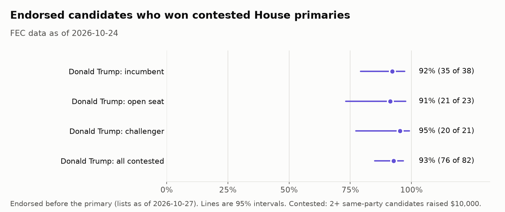
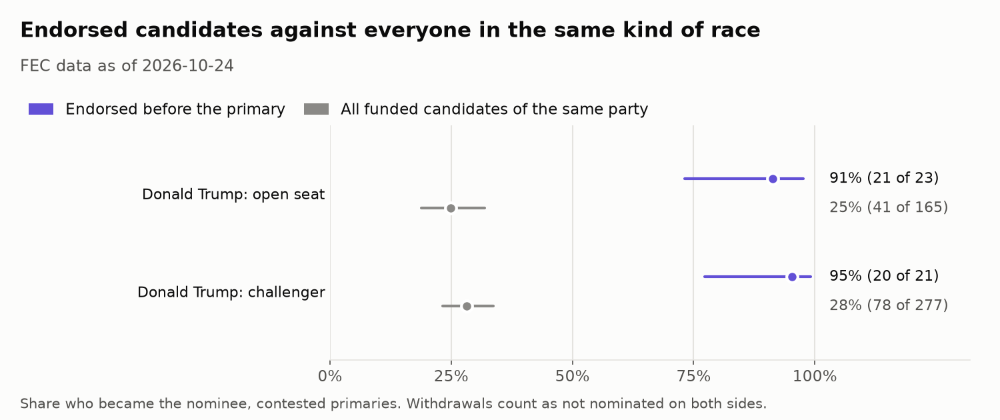
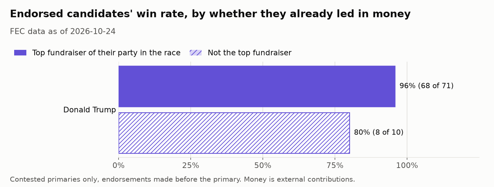
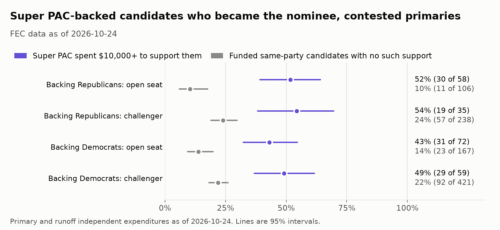

# Endorsements in the 2026 House Primaries

*Section 2b of the Midterm Money 2026 write-up. Endorsement lists read October 27 and 28, 2026. FEC fundraising data as of October 24, 2026. November nominees from the frozen pre-election predictions.*

## The question

How often did candidates endorsed before their 2026 House primary go on to win it? The plan was to split that rate by incumbents, open seats, and challengers, and by whether the primary was contested. The hard part is selection. Endorsers tend to pick candidates who were already likely to win, so a high win rate on its own says little about what an endorsement did. This section reports the rates next to two checks on that problem. It does not claim to measure an endorsement's effect.

Three endorsers are covered: Donald Trump and Club for Growth PAC on the Republican side, and Justice Democrats on the Democratic side. The Republican side is much larger, mostly because of Trump. Because so few groups publish a datable list, the section also treats super PAC primary spending as a kind of endorsement, which covers 261 super PACs from both parties.

All figures come from `scripts/build_endorsements_report.py`, which reads the database and the research files and writes the charts and [`endorsements_numbers.json`](figures/endorsements_numbers.json). Every number below can be checked against that file.

## How endorsers and endorsements were identified

An endorser is tracked when it publishes a public list of its 2026 House primary endorsements and each endorsement can be dated. The same rule applies to both parties. The endorsers and where their lists live are in [`data/manual/endorsers.csv`](../data/manual/endorsers.csv), and every endorsement is in [`data/manual/endorsements.csv`](../data/manual/endorsements.csv) with a source link.

- **Donald Trump.** Ballotpedia keeps a table of his 2026 House endorsements, and each row links the Truth Social post that made it. The page was saved from a browser because Ballotpedia blocks automated reads. The endorsement date is read from the post itself: Truth Social runs on Mastodon, whose post IDs carry the time the post was made. Rows Ballotpedia marks as general election only were dropped (16), along with special elections (2), which leaves 230 primary endorsements.
- **Club for Growth PAC and Justice Democrats.** Both publish a list page with no dates, so each candidate is dated from archived copies of the page in the Wayback Machine. The archive limits scripted downloads. 18 Club for Growth copies were downloaded weekly before the limit hit. The rest were saved from a browser or fetched one at a time, picked to fall just before each cluster of primaries. In all, 21 Club for Growth copies (February 2025 to August 2026) and 4 Justice Democrats copies (March to August 2026) were read.

A list page changes over time, so dating a candidate by the first copy that names them does not work. Club for Growth cleared its list for the 2026 cycle in February 2025, removed some candidates who left to run for other offices, and re-listed one candidate after his primary. Each candidate is dated by the first copy in the unbroken run of copies that lists them on the last copy before their primary. That copy came on or after the real endorsement, so the date can only make the timing rule stricter. A candidate dropped from the list before their primary is treated as a withdrawn endorsement and left out. That removed 11 Club for Growth names, most of them leftovers from the 2024 list. A candidate removed after their primary keeps their date, so a loss is never quietly dropped.

This leaves 18 Club for Growth endorsements and 23 from Justice Democrats. One Justice Democrats candidate, Saikat Chakrabarti (CA-11), is not in this project's FEC data: the FEC marks him as not having raised funds, and the pipeline only loads candidates who have. He is left out rather than added by hand.

Two other Democratic-side groups were checked and dropped. The Working Families Party list had no archived copies in 2026, and EMILY's List's list page is a roster that keeps every past candidate, so it cannot date a 2026 endorsement.

### The rules for counting

- **Timing.** An endorsement counts only if it came on or before the candidate's primary. Primary and runoff dates come from the FEC's 2026 primary dates document, in [`data/manual/primary_dates.csv`](../data/manual/primary_dates.csv). Trump made one endorsement after the primary, one between the primary and the runoff, and one with no linked post to date it. Club for Growth's list first shows 2 candidates only after their primaries (Derek Merrin in OH-09 and David Flippo in NV-02). All of these are left out of the win rates. Trump's runoff endorsement is Brandon Herrera in TX-23, made after Trump's earlier pick there, incumbent Tony Gonzales, was forced into a runoff. Gonzales then left the runoff ballot, and his endorsement counts as a loss. Backing the winner afterward does not erase it.
- **Winning** means becoming the November nominee, the same rule as the billionaire section. In California and Washington, every candidate who advances from the top-two primary counts as a win. A candidate whose FEC ID is not the nominee's still counts as the nominee when the names match and it is the same person filed twice, but not when it is a different person with the same last name (Mayra and Eric Flores in TX-34). Louisiana's House primaries were moved to November 3, so its 3 Trump endorsements and 1 Club for Growth endorsement are pending.
- **Never on the ballot.** 11 candidates Trump endorsed early, all of them sitting members, retired or left the race before their primary. Ballotpedia records them as not on the primary ballot. They did not lose a primary, so they are left out of the win rates rather than counted as losses.
- **Two candidates in one primary.** If an endorser backs two people on the same ballot before the vote, one of them has to lose, so both would be left out. That did not happen for any of the three endorsers.
- **Contested** means at least two candidates of the same party in the race each raised $10,000 or more from outside sources. Full primary ballots are not in the database, so this is a proxy. A hand check of 15 random races against Wikipedia's results agreed on 9 of 11 that could be judged. Both misses had a second name on the ballot who raised less than $10,000, so the proxy measures a funded contest, which is a stricter test than a contested ballot.

As a check on the scoring, every Trump outcome was compared with Ballotpedia's own result for that row. They agree on 227 of 227 decided endorsements. The two organizations' lists carry no results, so their outcomes rest on the nominee list alone.

## Findings

### Win rates

| Contested primary | Donald Trump | Club for Growth PAC | Justice Democrats |
|---|---|---|---|
| Incumbent | 92% (35 of 38) | 100% (2 of 2) | 100% (4 of 4) |
| Open seat | 91% (21 of 23) | 83% (5 of 6) | 71% (5 of 7) |
| Challenger | 95% (20 of 21) | 100% (2 of 2) | 75% (6 of 8) |
| All contested | 93% (76 of 82) | 90% (9 of 10) | 79% (15 of 19) |

The lines on the chart are 95% Wilson intervals. Trump's groups have 21 to 38 candidates each. The two organizations have 2 to 8, and their intervals span most of the chart, so differences between groups or between endorsers are not something these data can show.

"Challenger" is the FEC's label for a candidate running in a seat that already has an incumbent. For Trump it almost always means a Republican running in the primary for a seat a Democrat holds. For Justice Democrats it means a primary challenge to a sitting Democrat.

Endorsed candidates in primaries with no second funded candidate won every time: 100% (131 of 131) for Trump, 100% (5 of 5) for Club for Growth, and all 4 for Justice Democrats. Those are kept out of the headline, because an unopposed candidate wins whether or not anyone endorses them.

The endorsed candidates who lost were:

- **Trump (6):** Cory Mills (FL-07), Andy Ogles (TN-05), and Tony Gonzales (TX-23), all incumbents. Catalina Lauf (FL-19) and Jackson Lahmeyer (OK-01) in open seats. Amir Hassan (MI-08), a challenger.
- **Club for Growth (1):** Jessi Ebben (WI-07), in an open seat.
- **Justice Democrats (4):** Junaid Ahmed (IL-08) and Kat Abughazaleh (IL-09) in open seats, and Cori Bush (MO-01) and Nida Allam (NC-04), who challenged sitting Democrats.

### Against candidates who were not endorsed

The baseline is every candidate of the same party in the same kind of contested primary who raised $10,000 or more and was not endorsed by any of the three. A person with two FEC filings counts once, and Minnesota's Democratic-Farmer-Labor candidates count as Democrats.

- **Republicans:** in open seats, 13% (18 of 138) of unendorsed candidates became the nominee, against 91% (21 of 23) for Trump's picks and 83% (5 of 6) for Club for Growth's. Among challengers it was 22% (55 of 251), against 95% (20 of 21) for Trump.
- **Democrats:** in open seats, 21% (49 of 230), against 71% (5 of 7) for Justice Democrats. Among challengers, 24% (115 of 472), against 75% (6 of 8).

The gaps are large, but they are not estimates of what an endorsement does. A contested open seat has several funded candidates and only one nominee, so the baseline rate is low by construction, and endorsers are choosing among those same candidates with knowledge of who is ahead.

There is no incumbent baseline. The database cannot tell a member who lost a primary from one who retired or ran for Senate or governor. All three show up as an incumbent who did not become the nominee. Of the 42 contested Republican incumbents scored that way, 14 are on Trump's list, and Ballotpedia records only 3 of those as primary losses (Mills, Ogles, and Gonzales). Many of the other 28 ran for statewide office or retired. A baseline built on these would mostly measure departures, not primary losses.

### Did endorsements go to the front-runners?

In contested primaries, most endorsed candidates were already the top fundraiser of their party in the race: 88% for Trump, 70% for Club for Growth, and 58% for Justice Democrats. For each endorser, the money leaders won more often than the rest: 94% against 80% for Trump, 100% against 67% for Club for Growth, and 91% against 62% for Justice Democrats. The second group is small for every endorser (3 to 10 candidates), so the gaps are rough. The pattern fits the selection problem, though. Endorsements went mostly to candidates who already looked like the favorite by the standard the rest of this project uses, and the ones that did not go to a front-runner did worse.

Justice Democrats backed the fewest front-runners and had the lowest contested win rate. 15 of its 19 contested endorsements were challengers to sitting Democrats or newcomers in open seats, which is a harder set of races than Trump's, where incumbents make up nearly half. That does not show its endorsement mattered less.

### Super PAC spending as a kind of endorsement

Few groups publish a datable endorsement list, but many back primary candidates with money. A super PAC that spends heavily to support a candidate in their primary is placing a public bet on them, much like an endorsement. That spending is filed with the FEC for a specific election, so unlike an undated list it can never come after the primary it was meant for.

Here, a super PAC backs a candidate when it spent $10,000 or more in independent expenditures supporting them in their primary or runoff, the same floor as the billionaire section. Spending against a candidate is not counted as backing their rivals. As of October 24, 2026, 261 super PACs backed 324 House candidates this way, in 624 PAC and candidate pairs. A candidate backed by several PACs counts once in the totals below, and a PAC that backed two candidates in one primary is left out for that race, as with the endorsers. Seven filings named no candidate ID and four named candidates outside this project's FEC data, so those could not be scored.

In contested primaries, 58% (67 of 115) of super PAC-backed Republicans and 55% (92 of 168) of super PAC-backed Democrats became the nominee. That is well below the three endorsers. Part of the difference is the kind of race: 59 of the 283 contested super PAC-backed candidates were incumbents, against 38 of Trump's 82.

Compared with funded candidates that no super PAC backed in the same kind of race:

| Contested primary | Super PAC-backed | Not backed |
|---|---|---|
| Republicans, open seat | 52% (30 of 58) | 10% (11 of 106) |
| Republicans, challenger | 54% (19 of 35) | 24% (57 of 238) |
| Democrats, open seat | 43% (31 of 72) | 14% (23 of 167) |
| Democrats, challenger | 49% (29 of 59) | 22% (92 of 421) |

The money-leader check is sharper here than for any endorser. Half of super PAC-backed contested candidates (50%) were already their party's top fundraiser in the race. Those won 91% of the time. The other half won 21% of the time, close to the rate for candidates with no super PAC backing at all. Super PAC money went mostly to candidates who were winning the fundraising race on their own, and when it backed someone who was not, it usually lost.

The super PACs that backed the most decided candidates in contested primaries:

| Super PAC | Backed candidates who won |
|---|---|
| Defend American Jobs | 19 of 19 |
| Protect Progress | 18 of 19 |
| Conservatives for American Excellence | 16 of 17 |
| Project 218 | 8 of 13 |
| Think Big | 12 of 13 |
| Working Families Party PAC | 8 of 12 |
| Pro-Choice Majority Action | 5 of 11 |
| American Mission | 10 of 10 |
| American Priorities (AP) | 9 of 10 |
| Justice Democrats PAC | 8 of 10 |
| GOPAC Election Fund | 5 of 9 |
| SF Solidarity PAC | 3 of 9 |
| VoteVets | 6 of 9 |
| Club for Growth Action | 6 of 8 |
| Freedom Caucus Fund | 6 of 8 |
| WFW Action Fund | 7 of 8 |

Defend American Jobs and Protect Progress belong to the Fairshake crypto network, and Think Big and American Mission to the Leading the Future AI industry network, as sourced in [`data/manual/pac_industries.csv`](../data/manual/pac_industries.csv). Their spending is covered from the money side in [Tech money in the 2026 House races](tech-money.md). Justice Democrats PAC and Club for Growth Action share their names with two of the endorsers above.

## Method and caveats

- **Endorsers choose whom to back.** Nothing here separates the effect of an endorsement from an endorser's choice of who to endorse. Trump endorsed most Republican incumbents seeking reelection, often in batches long before any primary, and incumbents rarely lose primaries. The rates describe how each endorser's picks did. They do not say those picks would have done worse without the endorsement.
- **Super PAC spending is not the same as an endorsement.** A super PAC can spend late, once its candidate is already ahead, and the money-leader check uses each candidate's own fundraising through October, after the primaries. Both lean toward making backed candidates look stronger than they were when the money was spent. Super PAC rates also count a withdrawal as not becoming the nominee, because the spending data cannot tell the two apart.
- **Uneven sizes.** Trump accounts for 82 of the 111 contested endorsements. Club for Growth's 10 and Justice Democrats' 19 are too few for their rates to be compared with Trump's, or with each other, with any confidence.
- **Archived dates.** The two organizations' dates come from a few archived copies, so a candidate endorsed shortly before their primary can look like they were first listed after it and be left out. Justice Democrats' earliest copy is from March 2, 2026, so every candidate already on the list then is dated March 2, even if the endorsement came in 2025.
- **The contested proxy** agreed with a hand check on 9 of 11 races, and it misses primaries where the second candidate raised little money. Some primaries counted as uncontested here had more than one name on the ballot.
- **Fundraising** is external contributions (money raised from others, not the candidate's own loans) as of October 24, 2026, which is after every primary except Louisiana's. The "top fundraiser" check uses totals that include money raised after the primary, which can favor the winner.
- **Matching.** Each endorsement was matched to an FEC candidate ID by race and name, with hand-checked fixes for duplicate filings and the Nehls twins in TX-22. When a list names a district that was later redrawn, an exact name match elsewhere in the same state is used: Justice Democrats lists Greg Casar under TX-35, and his 2026 filing is in TX-37. The only endorsee left unmatched is Chakrabarti.

## What's next

- Score Louisiana's 4 pending endorsements after its November 3 primary.
- After November 3, check whether endorsed nominees did better in the general election than the money model expected.
