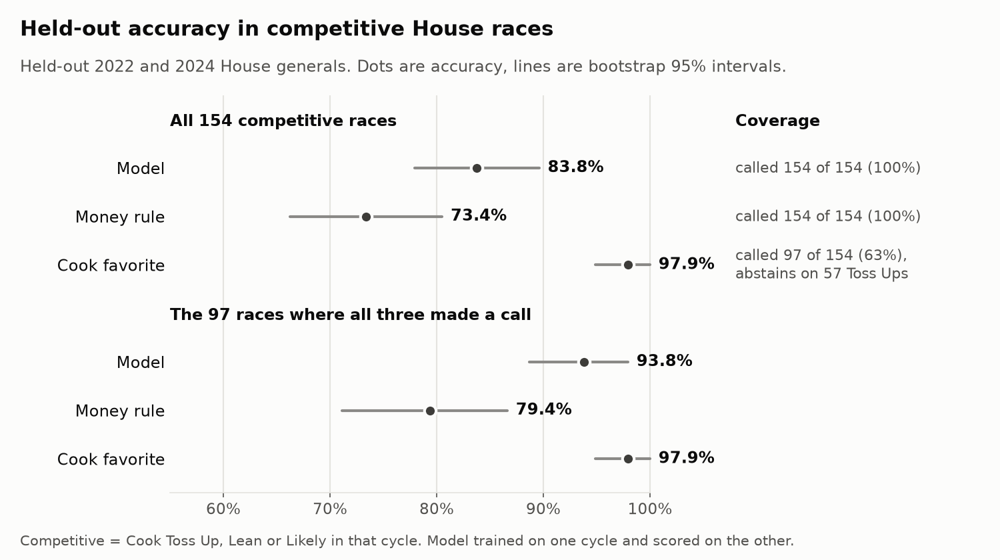
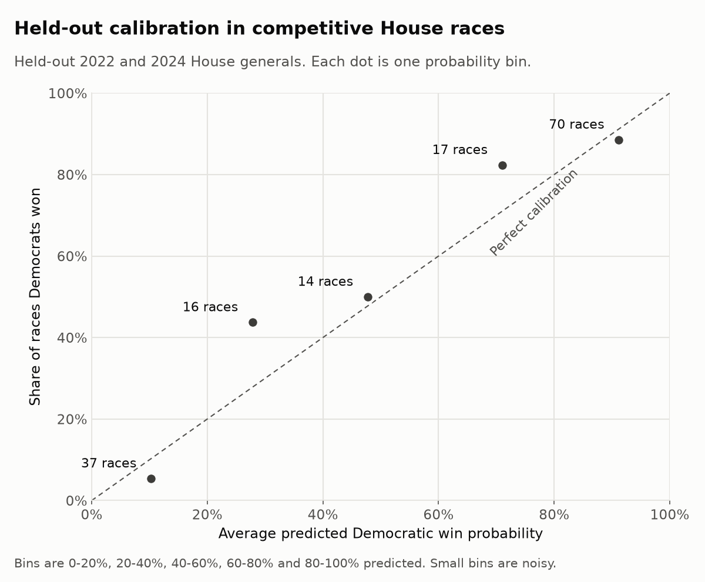
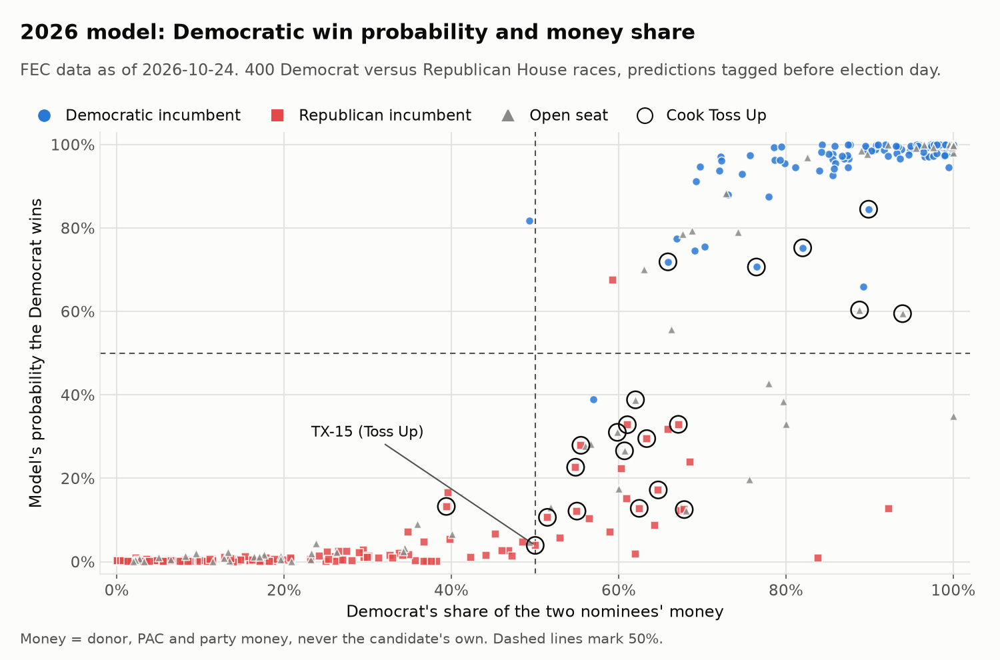

# Money and Winning in the 2026 House Races

*Section 3 of the Midterm Money 2026 write-up, pre-election version. House general elections only. 2026 predictions use FEC data as of 2026-10-24, and the model is evaluated on held-out 2022 and 2024 races. Written October 26, 2026. A scoring section will be added after the November 3 election.*

## The question

Does money predict who wins a House general election once you account for incumbency and district partisanship? Raw fundraising and winning line up closely, but a lot of that is because sitting members and candidates in friendly districts raise more money. The useful question is whether a fundraising edge still tells you something after those two are known.

This is a question about prediction, not cause. Money follows likely winners. Donors and PACs give to incumbents and to candidates who look strong, and strong candidates raise more. So a link between money share and winning can't show that spending moved any votes, and nothing in this section tries to measure that.

All figures come from `scripts/build_money_winning_report.py`, which reads only the frozen prediction files in [`reports/predictions/`](predictions/README.md) and writes the charts and [`money_winning_numbers.json`](figures/money_winning_numbers.json). It never opens the database or the network. Every number below can be checked against that JSON file, except a few facts that say they come from the predictions README. In addition, `tests/test_money_winning_report.py` checks that each cited number appears here as written.

## What was predicted, and when

Two sets of predictions for the 2026 House generals were committed to git and pushed to GitHub before election day:

- **Simple predictions**, tagged `pre-election-simple` at commit `c18c0db`. For every race, the nominee who raised more money from donors, PACs and parties (the **money rule**) sits next to the party Cook Political Report rates ahead (the **Cook favorite**). No model is involved.
- **Model predictions**, tagged `pre-election-model` at commit `eb42038`. A logistic regression trained on the 2022 and 2024 House generals gives each 2026 Democrat versus Republican race a probability that the Democrat wins.

Both prediction files are frozen. They are never edited after their tag, and any correction goes in a new dated file next to them. One such file exists: `supplementary-2026-10-26.json`, a check of what money adds to the model that was run after the model tag on 2022 and 2024 data only. The [predictions README](predictions/README.md) is the full technical record, with dated notes for everything added after a tag.

Money is a candidate's money from others: individual contributions net of refunds, plus PAC and party money net of refunds. A candidate's own contributions and loans never count. **Money share** is the Democrat's share of the two major nominees' money.

## Findings

### The money rule and Cook in 2026

The simple file covers all 435 races. Of these, 410 Democrat versus Republican races can be compared with Cook. Cook rates 21 Toss Ups and so names no favorite in them, and no race has an exact 50% money split, so both rules made a call in 389 races. They name the same party in 369 and different parties in 20.

In 19 of the 20 the Democrat leads on money and Cook favors the Republican. In the other 1 (NV-01) the Republican leads on money and Cook favors the Democrat. The full list:

| Race | Nominees | Money leader | Democratic money share | Cook rating |
|---|---|---|---|---|
| AL-02 | Shomari Figures (D) vs. Rhett Marques (R) | Democratic | 57.0% | Likely R |
| CO-04 | Eileen Laubacher (D) vs. Lauren Boebert (R) | Democratic | 92.2% | Solid R |
| CO-05 | Jessica Killin (D) vs. Jeff Crank (R) | Democratic | 67.4% | Lean R |
| FL-07 | Bale Dalton (D) vs. Ryan Elijah (R) | Democratic | 77.9% | Likely R |
| FL-09 | Darren Soto (D) vs. Dan Green (R) | Democratic | 89.2% | Likely R |
| FL-27 | Eliott Rodriguez (D) vs. María Elvira Salazar (R) | Democratic | 53.0% | Lean R |
| GA-14 | Shawn Harris (D) vs. Clay Fuller (R) | Democratic | 83.8% | Solid R |
| KY-06 | Zach Dembo (D) vs. Ralph Alvarado (R) | Democratic | 60.0% | Lean R |
| ME-02 | Matthew Dunlap (D) vs. Paul LePage (R) | Democratic | 56.0% | Lean R |
| MN-01 | Jake Johnson (D) vs. Brad Finstad (R) | Democratic | 59.0% | Lean R |
| NV-01 | Dina Titus (D) vs. Carrie Buck (R) | Republican | 49.3% | Likely D |
| NV-02 | Teresa Benitez-Thompson (D) vs. David Flippo (R) | Democratic | 51.9% | Likely R |
| NY-21 | Blake Gendebien (D) vs. Anthony Constantino (R) | Democratic | 100.0% | Lean R |
| SC-01 | Nancy Lacore (D) vs. Jenny Costa Honeycutt (R) | Democratic | 79.7% | Lean R |
| TN-05 | Chaz Molder (D) vs. Charlie Hatcher (R) | Democratic | 68.0% | Solid R |
| TN-09 | Justin Pearson (D) vs. Brent Taylor (R) | Democratic | 75.7% | Solid R |
| TX-23 | Katy Padilla Stout (D) vs. Brandon Herrera (R) | Democratic | 80.0% | Likely R |
| TX-35 | Johnny Garcia (D) vs. Carlos De La Cruz (R) | Democratic | 56.7% | Lean R |
| VA-05 | Tom Perriello (D) vs. John McGuire (R) | Democratic | 64.3% | Likely R |
| VA-06 | Beth Macy (D) vs. Ben Cline (R) | Democratic | 62.0% | Solid R |

NY-21 shows 100.0% because the Republican nominee had reported no money from others in the snapshot. Most of these 20 are rated Lean or Likely, where Cook expects a real contest. According to a dated note in the [predictions README](predictions/README.md), two of the Solid R ratings in the table (GA-14 and VA-06) are inferred from PVI rather than taken from Cook's own list (see [Method and caveats](#method-and-caveats)).

### How the model did on races it had not seen

The model gives each race a probability that the Democrat wins, from three inputs: money share, incumbency (+1 for a Democratic incumbent, -1 for a Republican incumbent, 0 for an open seat), and the district's Cook PVI with Democratic leans positive. To test it fairly, each cycle was held out in turn. The model was fit on 2022 and scored on 2024, then fit on 2024 and scored on 2022. The money rule and the Cook favorite need no training and were scored on the same races.

Across all 688 held-out races, the model called 96.4% correctly (Brier score 0.027). The money rule called 92.4%. Cook called 99.7% of the races it made a call in, but it made a call in 631 of 688 (91.7%) because it abstains on Toss Ups. Most of these races are safe seats, which are easy to call, so the overall numbers say little about close races.

Competitive races are where the three predictors differ. There are 154 competitive races, the ones Cook rated Toss Up, Lean or Likely in that cycle.

| Predictor | Races called | Coverage | Accuracy, with bootstrap 95% interval |
|---|---|---|---|
| Model | 154 of 154 | 100% | 83.8% [77.9%, 89.6%] (Brier score 0.119) |
| Money rule | 154 of 154 | 100% | 73.4% [66.2%, 80.5%] |
| Cook favorite | 97 of 154 | 63.0% | 97.9% [94.8%, 100.0%] |

Cook's accuracy is the highest, but it comes from fewer races. It made no call in 57 Toss Ups, which are the hardest races to call, and abstentions are not counted as misses. The fairest comparison uses the 97 competitive races where all three made a call (all rated Lean or Likely). On those, the model was right on 93.8%, the money rule on 79.4%, and Cook on 97.9%.

A paired bootstrap resamples those 97 races and scores every predictor on the same draw, which gives an interval for each difference:

| Difference on the shared 97 races | Estimate | 95% interval |
|---|---|---|
| Model minus money rule | +14.4 points | [+6.2, +23.7] |
| Model minus Cook | -4.1 points | [-9.3, 0.0] |

The first interval excludes 0, so the model's edge over the money rule is a real difference in this sample. The second reaches 0 at its upper end, so the model and Cook can't be told apart here.

The model beating the money rule does not mean money is what helps. The model already includes money, so this gap measures what incumbency and PVI add on top of money. The question this section asks runs the other way: what does money add on top of incumbency and PVI?

### What money adds beyond incumbency and PVI

The model was also fit without money share, using incumbency and PVI only, and scored on the same held-out races. On competitive races, adding money lowered the Brier score from 0.131 to 0.119 and raised accuracy from 81.8% to 83.8%. Lower Brier scores are better.

Those gains come without an interval in the tagged evaluation, so a paired bootstrap was run afterward on the same held-out 2022 and 2024 predictions (1,000 draws, seed 2026). No 2026 data was used, and the tagged files are unchanged.

| Held-out races | Brier gain from adding money | Accuracy gain from adding money |
|---|---|---|
| Competitive (154) | 0.011 [-0.002, 0.026] | +1.9 points [-1.3, +5.2] |
| All (688) | 0.0036 [0.0003, 0.0071] | +0.4 points [-0.3, +1.3] |

This is the main finding of the section. Adding money to incumbency and PVI improves the held-out Brier score a little, but on competitive races both intervals include 0, so the gain can't be told apart from noise in this sample. Over all races the Brier interval sits just above 0, but those races are mostly safe seats, the accuracy interval includes 0, and the bootstrap treats races as independent when races in the same year share a national mood. The true intervals are probably wider than shown. The fair reading is that money share may add a little beyond incumbency and PVI, and two cycles of data are not enough to show it clearly.

### Calibration

A model is calibrated if its probabilities match how often things happen: of the races where it says 70%, the Democrat should win about 70%.

| Predicted probability | Races | Average prediction | Democrats won |
|---|---|---|---|
| 0.0 to 0.2 | 37 | 0.10 | 0.05 |
| 0.2 to 0.4 | 16 | 0.28 | 0.44 |
| 0.4 to 0.6 | 14 | 0.48 | 0.50 |
| 0.6 to 0.8 | 17 | 0.71 | 0.82 |
| 0.8 to 1.0 | 70 | 0.91 | 0.89 |

The middle bins hold fewer than 20 races each, so their gaps are noisy. The 0.2 to 0.4 bin stands out: the model gave those Democrats about a 28% chance on average and they won 44% of the time. In the 0.6 to 0.8 bin the Democrats won more often than predicted too. Read low and high probabilities in close races as less certain than they look.

### What the coefficients say

Refit on all 688 training races, the model's inputs all point in the expected direction: more money share, a Democratic incumbent, and a more Democratic-leaning district each raise the Democrat's chances, and the same holds in reverse for Republicans.

- **PVI matters most.** One standard deviation of PVI moves the model's log-odds about 2.2 times as much as one standard deviation of money share. Each point of PVI multiplies the odds of the leaning party's nominee winning by about 1.29.
- **Incumbency** multiplies the odds by about 3.4 for the incumbent's party, compared with an open seat.
- **Money share** multiplies the odds by about 1.52 for each 10 points of share. In an open seat with an even PVI, going from 45% to 55% of the money moves the Democrat's chance from 39.8% to 50.2%, about 10 points. At the training medians (an open seat at R+1), the same change moves it from 33.9% to 43.9%. By symmetry, the same shift in a Republican's money share moves the Republican's chance by the same amount.

The money coefficient describes what the fitted model leans on. It doesn't say what an extra dollar of spending would do, and the previous section shows that its added value on held-out competitive races is within noise.

### The 2026 model predictions

The model makes predictions for 400 races: the 410 Democrat versus Republican races minus 10 races where a third-party or independent nominee raised more than one of the major-party nominees. Among the 400, there are 164 Democratic incumbents, 168 Republican incumbents, and 68 open seats. The model favors the Democrat in 191 and the Republican in 209.

The chart shows how incumbency separates the races. Most races with a Democratic incumbent sit near the top and most with a Republican incumbent sit near the bottom, whatever the money share. Open seats spread across the middle. Races with a Democratic money edge and a Republican incumbent fall mostly below 50%, and the same pattern holds the other way around (NV-01 has a Democratic incumbent and a slight Republican money edge, and sits well above 50%).

**The most uncertain races.** Only 3 races fall between 0.4 and 0.6. The four closest to an even call are AZ-01 (0.56, an open seat rated Lean D), FL-07 (0.43, an open seat rated Likely R), NC-11 (0.59, an open seat rated Toss Up), and FL-22 (0.60, an open seat rated Toss Up). All four are open seats, where incumbency gives the model nothing to lean on.

**Toss Ups.** Cook rates 21 Toss Ups among the 400. The model favors the Republican in 15 and the Democrat in 6. That split follows incumbency: of the 16 Toss Ups with an incumbent (12 Republican, 4 Democratic), the model favors the incumbent's party in every one. In the 5 open-seat Toss Ups it favors the Democrat in 2 (FL-22 and NC-11) and the Republican in 3. Several Toss Up probabilities are far more confident than a Toss Up rating implies: TX-15 (0.04), MI-04 (0.11), VA-01 (0.12), OH-07 (0.12), PA-08 (0.13), and MI-07 (0.13). Each has a Republican incumbent, and these probabilities come mostly from incumbency and PVI. See the limitations below for why they should be read as the model's lean, not a confident call.

**Where the model and Cook disagree.** Among races where Cook names a favorite, the model and Cook name different parties in 6:

| Race | Nominees | Model's Democratic probability | Cook rating |
|---|---|---|---|
| FL-09 | Darren Soto (D) vs. Dan Green (R) | 0.66 | Likely R |
| IA-01 | Christina Bohannan (D) vs. Mariannette Miller-Meeks (R) | 0.10 | Lean D |
| IA-03 | Sarah Trone Garriott (D) vs. Zach Nunn (R) | 0.24 | Lean D |
| NJ-07 | Rebecca Bennett (D) vs. Thomas Kean Jr. (R) | 0.32 | Lean D |
| PA-07 | Bob Brooks (D) vs. Ryan Mackenzie (R) | 0.22 | Lean D |
| PA-10 | Janelle Stelson (D) vs. Scott Perry (R) | 0.15 | Lean D |

In each of the six, the model sides with the incumbent's party. FL-09 has a Democratic incumbent in a Likely R seat, and the other five have Republican incumbents in Lean D seats.

The model and the money rule name different parties in 38 races. That list is in the [predictions README](predictions/README.md#the-2026-predictions).

## Method and caveats

- **No term for the national environment.** The model learns from two cycles and has no input for how the national mood favors one party in a given year. Both 2022 and 2024 were close national years, so the model has never seen a wave in either direction. With no national term, its probabilities in close races lean toward incumbents, and some Toss Up probabilities, such as the 6 below 0.15 listed above, are overconfident. The held-out calibration on competitive races shows the same thing at the low end.
- **The training money window tilts toward incumbents.** Training money for 2022 and 2024 is cycle-to-date, and FEC cycles start the day after the previous general election, so it includes the November and December after that election. The 2026 bulk file starts on January 1, 2025, and leaves those two months out. Money raised then goes mostly to sitting members, so training money shares lean slightly toward incumbents compared with 2026. Part of the money coefficient may reflect incumbency. The size of this effect was not measured.
- **2024 results come from Wikipedia.** The FEC had not published its official 2024 results, so 2024 outcomes come from Wikipedia's 2024 House elections page, pinned to a revision from after certification. 2022 results come from the FEC's official publication.
- **Cook's coverage includes inferred Solid ratings.** Cook ratings are read from Wikipedia, which lists only competitive seats. Every other seat is rated Solid D or Solid R from its PVI, in training and in 2026. These inferred ratings are almost always right, which lifts Cook's overall accuracy and coverage. The competitive comparisons above use only Cook's own ratings.
- **The bootstrap pools both cycles.** Intervals resample races from 2022 and 2024 together and treat them as independent. Races in the same year share a national mood, so the true uncertainty is probably wider.
- **Outside spending was not tested.** The plan was to test whether super PAC spending for and against each nominee improves the model on 2022 and 2024. That test was not done before the model tag, so the model uses candidate money only.
- **Missing money records.** In 38 races a major-party nominee has no FEC money record in the 2026 snapshot and counts as $0. Training left such races out. In every one the nominee with the missing record is the underdog in a Solid seat. Details are in the [predictions README](predictions/README.md).
- **Money snapshot.** 2026 money comes from the FEC bulk file pulled on 2026-10-24, which includes reports through October 14 (the pre-general deadline). Training money for 2022 and 2024 comes from each campaign's last report on or before its pre-general cutoff, so no money raised after election day leaks into the inputs.

## What's next

After November 3, this section will score the money rule, the Cook favorite, and the model against the 2026 results: accuracy and coverage on called races, the Brier score for the model, and the same competitive-race and shared-race comparisons as above. The prediction files stay as tagged. Results will come from the AP or state results first and switch to official results when they're published, and any race not yet called will be listed as pending. The outside spending test will also run on 2022 and 2024.
