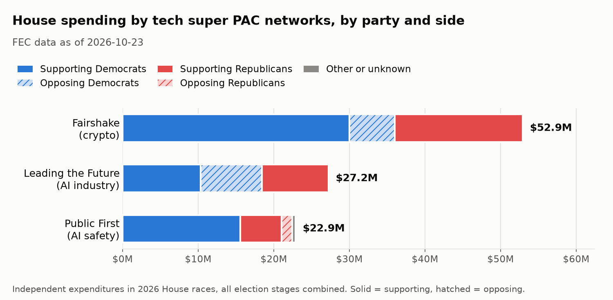
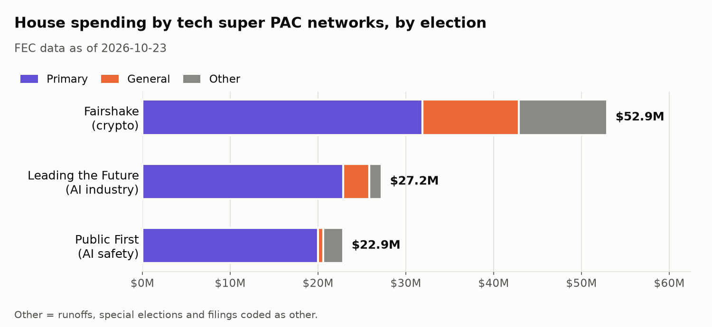
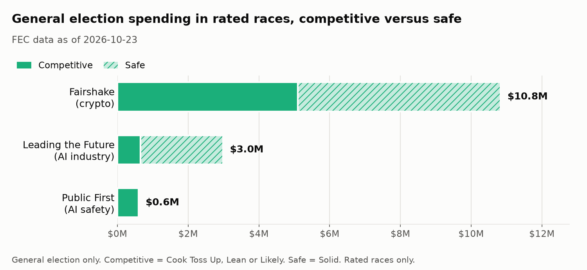

# Tech Money in the 2026 House Races

*Section 1 of the Midterm Money 2026 write-up. House races only. FEC data as of October 23, 2026.*

## The question

Three super PAC networks tied to crypto and AI policy are spending in 2026 House races. This section asks how much each network spent, which candidates it spent for or against, and which races the money went to. It reports what was spent and on whom. It does not try to measure whether the spending changed any result.

All figures come from `scripts/build_tech_money_report.py`, which reads the October 23 snapshot and writes the charts and [`tech_money_numbers.json`](figures/tech_money_numbers.json). Every number below can be checked against that file, except the validation percentages, which come from the validation table in the [README](../README.md#data-caveats).

## The networks and how they were identified

A network is a group of committees tied to the same organizers. Each committee was added to a network only if it had one of three kinds of public source: FEC evidence (a filing that names the parent group, a shared treasurer, or transfers between the committees), the group's own public statement, or a major news outlet naming the committee. The same standard was applied to all three networks. The committee list and the source for each row are in [`data/manual/pac_industries.csv`](../data/manual/pac_industries.csv).

| Network | Category | Committees (FEC ID) |
|---|---|---|
| Fairshake | Crypto | Fairshake (C00835959), Protect Progress (C00848440), Defend American Jobs (C00836221) |
| Leading the Future | AI industry | Think Big (C00923417), American Mission (C00916692), Leading the Future (C00916114) |
| Public First | AI safety | Jobs and Democracy PAC (C00928374), Defending Our Values PAC (C00928390), Public First (C00930503) |

The Leading the Future and Public First committees that share their network's name reported no House independent expenditures of their own. Those networks' spending runs through the other two committees in each row.

## Findings

### Total spending

Together, the three networks spent $102.99M on 2026 House races as of October 23.

| Network | House spending | Candidates |
|---|---|---|
| Fairshake | $52.91M | 87 |
| Leading the Future | $27.22M | 39 |
| Public First | $22.86M | 15 |

A candidate counts once per network, even if the network spent on them in both the primary and the general.

Public First's figure may be low. In a check against FEC committee totals, one of its committees came out about 11% below what it reported (see [Method and caveats](#method-and-caveats)). The same check put every Fairshake and Leading the Future committee within 1%.

### Who the money supported and opposed

Spending is split into four groups by the candidate's party and by whether the ad supported or opposed them, plus a fifth group for rows with no party. This shows each side separately instead of netting them into one number per party.

| Network | Supporting Democrats | Opposing Democrats | Supporting Republicans | Opposing Republicans | Other or unknown |
|---|---|---|---|---|---|
| Fairshake | $30.01M | $5.99M | $16.91M | $0 | $0 |
| Leading the Future | $10.30M | $8.16M | $8.77M | $0 | $0 |
| Public First | $15.56M | $0 | $5.46M | $1.44M | $0.40M |

All three networks spent on candidates in both parties. Most of each network's money supported candidates: $46.92M of Fairshake's, $19.07M of Leading the Future's, and $21.42M of Public First's. The opposition spending went one way per network. Fairshake and Leading the Future opposed only Democrats ($5.99M and $8.16M), and Public First opposed only Republicans ($1.44M).

All of Leading the Future's $8.16M in opposition went to one race (see NY-12 below).

The $0.40M in "Other or unknown" went to one candidate, Colin Allred in TX-33. These filings use an FEC candidate ID (H6TX33082) that is not in this project's candidate table and leave the party field blank, so the rows have no party. They are shown as their own group rather than assigned to a party by hand.

For each network, most of the money supporting Democrats and most of the money supporting Republicans was spent in primaries and runoffs. The share ranges from 54% (Fairshake, supporting Republicans) to 100% (Public First, supporting Democrats). Spending in a primary backs one candidate over others in the same party, so "supporting Democrats" does not mean spending against Republicans. The same is true of money supporting Republicans.

### Primary versus general election

Most of the money so far went to primaries.

| Network | Primary | General | Other |
|---|---|---|---|
| Fairshake | $31.88M (60%) | $10.98M | $10.05M |
| Leading the Future | $22.85M (84%) | $2.98M | $1.39M |
| Public First | $19.99M (87%) | $0.60M | $2.27M |

"Other" covers runoffs, special elections, and filings coded as other. The general election figures will change as committees file new reports before November 3.

### Competitive versus safe seats

This chart uses general election money only, because Cook ratings describe the November race. A primary in a safe seat can still be closely fought, so counting primary money here would misdescribe what it was for. Competitive means a Cook rating of Toss Up, Lean, or Likely. Safe means Solid.

| Network | Competitive seats (rated races) | Safe seats (rated races) |
|---|---|---|
| Fairshake | $5.10M | $5.73M |
| Leading the Future | $0.65M | $2.33M |
| Public First | $0.60M | $0 |

Fairshake's two numbers add up to less than its $10.98M general election total. The missing $0.15M was filed under Montana's at-large district code (MT-00), but Montana has had two districts since the 2022 election, so that row has no Cook rating and is left out of this chart.

### Top races

These are the ten House races with the most combined spending from the three networks.

| Race | Cook rating | Network spending | Primary | General | Other |
|---|---|---|---|---|---|
| NY-12 | Solid D | $21.32M | $21.32M | $0 | $0 |
| TX-18 | Solid D | $6.52M | $1.56M | $0 | $4.95M |
| MD-05 | Solid D | $5.53M | $5.53M | $0 | $0 |
| GA-13 | Solid D | $4.27M | $4.27M | $0 | $0 |
| NY-15 | Solid D | $2.54M | $2.53M | $5K | $0 |
| IL-07 | Solid D | $2.48M | $2.48M | $0 | $0 |
| IL-02 | Solid D | $2.25M | $2.25M | $0 | $0 |
| TX-35 | Lean R | $2.11M | $0.48M | $0 | $1.63M |
| FL-24 | Solid D | $2.06M | $2.06M | $0 | $0 |
| MI-13 | Solid D | $2.03M | $2.03M | $0 | $0 |

Nine of the ten are rated Solid D. In all ten, nearly all of the money went to a primary or a runoff, not to the general election.

The largest race is NY-12's Democratic primary, where two networks were on opposite sides of the same candidate. Public First spent $13.17M supporting Alexander Bores, and Leading the Future spent $8.16M opposing him.

## Method and caveats

- **Source.** Spending comes from the FEC bulk independent expenditure file, summed by committee, candidate, side, and election, with superseded filings dropped. Only House races are included. The full method is in the [README](../README.md#data-caveats).
- **No share of all outside spending yet.** This section reports each network's own spending and does not give its share of all House outside spending. A check against FEC committee totals found one network committee, Jobs and Democracy PAC (Public First), more than 5% below its FEC-reported total (-10.69%; the README has the full table). The share will be added after a re-check passes.
- **Public First's total may be low.** Because of that gap, Public First's figures above may understate its spending. Most of the gap appears to come from 24- and 48-hour filings that were amended to $0 after the committee's periodic report. Every Fairshake and Leading the Future committee was within 1% of its FEC-reported total.
- **The data keeps changing.** Committees file new 24- and 48-hour reports through Election Day. These figures are a snapshot as of October 23, 2026.
- **Party** comes from the FEC candidate record, or from the filing when the candidate is not in that record. DFL (Minnesota's Democratic party) counts as Democratic.
- **Cook ratings** for seats that no forecaster rates as competitive are inferred as Solid D or Solid R from the district's PVI. The README explains how.
- **Scope.** Only the three networks above are counted. Other committees with ties to the tech industry are not included, and neither are direct contributions to campaigns.

## What's next

After November 3, this section will add the same networks' Senate spending and a layer of tech billionaire donors, chosen by one rule applied the same way to donors of both parties.
